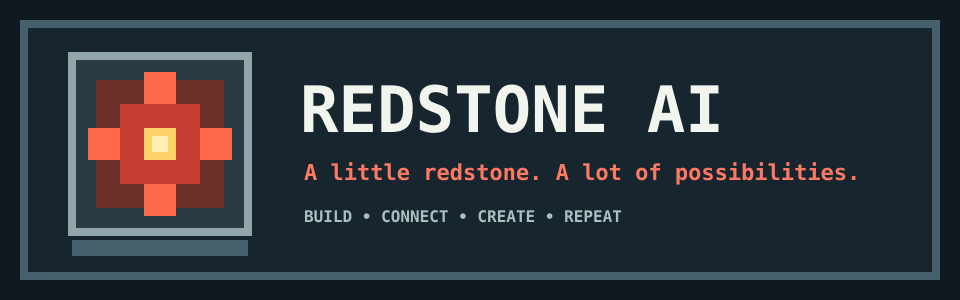

<div align="center">



# REDSTONE AI

### A little redstone. A lot of possibilities.

**An interactive AI companion built to make everyday technology feel simpler, more natural and more accessible.**

[](JOURNAL.md)
[](JOURNAL.md)
[](JOURNAL.md)

**[Enter the Workshop](#-the-workshop) · [Explore the Redstone Network](#-the-redstone-network) · [Read the Quest Log](JOURNAL.md)**

</div>

---

> [!TIP]
> **Your mission:** bring different ways of interacting with technology into one helpful companion. Less switching between devices. More getting things done.

## ⛏️ The world we're trying to improve

A simple task can sometimes require several devices, apps and interfaces. That can be frustrating for anyone, especially people who find conventional interfaces difficult to use.

**Redstone AI is an experiment in making those interactions simpler.** The idea is one compact assistant that can bring together voice, touch and other natural ways of communicating with technology.

This is not a finished product yet. We're building, testing and learning one block at a time.

## 🧰 The Workshop

Here's the current build. Think of each component as a block with its own job.

| Block | Its ability | Build status |
|---|---|---|
| **Raspberry Pi Zero 2 W** | The central brain of the device | Acquired |
| **INMP441 microphone** | Listens for voice input | Tested — capture works; sensitivity needs improvement |
| **Speaker** | Gives audio feedback | Acquired — integration in progress |
| **Audio amplifier** | Powers the speaker properly | To integrate |
| **5-inch touchscreen** | Gives the assistant a visual, touch interface | Planned |
| **Camera** | Lets us explore hand-gesture interaction | Planned |
| **Battery + power system** | Makes the build portable | Under consideration |

The inventory can change as the prototype develops. No planned feature is being presented as completed.

## 🔴 The Redstone Network

The device is designed as a team of parts, not one magic block.

```text
             [ USER ]
          voice / touch / gestures
                  |
                  v
        +---------------------+
        |     REDSTONE AI     |
        |                     |
        |  [Microphone]       |
        |  [Touchscreen]      |
        |  [Camera - planned] |
        +----------+----------+
                   |
                   v
        +---------------------+
        | Raspberry Pi Zero 2W|
        |  Main device brain  |
        +----+-----------+----+
             |           |
             v           v
        [ Speaker ]   [ Laptop ]
        audio out     development /
                      heavier local work

             . . . . . . . .
             Optional online services
             when network access helps
```

**The computing strategy**

- **Raspberry Pi:** device-side interaction, audio hardware and lightweight control.
- **Laptop:** development, testing and potentially heavier local processing.
- **Online services:** optional capabilities that may benefit from network access.

The final division of work is still being evaluated. The goal is to keep the experience responsive without asking the Pi Zero 2 W to do absolutely everything.

## 📦 Crafting recipes

A few of the combinations we're working towards:

| Recipe | Ingredients | Result |
|---|---|---|
| Voice input | INMP441 + Raspberry Pi | Audio captured for processing |
| Spoken feedback | Raspberry Pi + amplifier + speaker | Audio response from the device |
| Touch interaction | Touchscreen + interface software | A visual way to control the assistant |
| Gesture experiments | Camera + recognition software | Explore hands-free interaction |

These are design recipes, not claims that every combination is already working.

## 🗺️ Quest Log

Every good world starts with a few quests.

- [x] Choose the initial hardware direction.
- [x] Acquire the Raspberry Pi Zero 2 W, microphone and speaker.
- [x] Get microphone audio capture working.
- [x] Start the functional analysis and define the service functions.
- [ ] Improve microphone input quality.
- [ ] Integrate and test audio output.
- [ ] Select and integrate the touchscreen.
- [ ] Explore camera-based hand gestures.
- [ ] Design and build the portable enclosure.
- [ ] Develop and test the interaction software.
- [ ] Bring the hardware and software together into a working prototype.

<details>
<summary><b>🧪 Current build notes</b></summary>

- The INMP441 microphone captures audio, but its input is currently quiet.
- The speaker has been acquired; the amplifier and audio integration still need work.
- The touchscreen and camera are planned components.
- The project is exploring a split-computing approach to keep the Raspberry Pi's workload realistic.

</details>

## 📜 The Journal

The workshop has a journal. It records decisions, experiments, progress and problems — including the bits that don't work on the first try.

**[Open the development journal →](JOURNAL.md)**

## 🧑‍🔧 The builder

Redstone AI is an independent student engineering project by **Saad Zakaria**, developed in Morocco.

Built around curiosity for artificial intelligence, embedded systems, electronics and practical problem-solving.

---

<div align="center">

### ONE BLOCK AT A TIME.

*Plan it. Build it. Test it. Improve it.*

[](JOURNAL.md)

</div>
