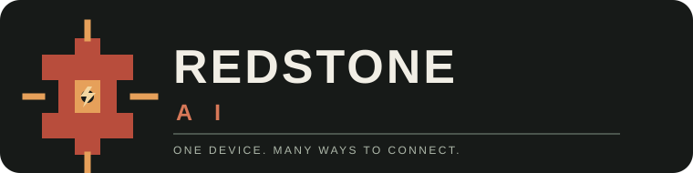

<div align="center">



# REDSTONE AI

### A little redstone. A lot of possibilities.

**An interactive AI companion built to make everyday technology feel simpler, more natural and more accessible.**

[](#current-focus)
[](#the-workshop)
[](#the-builder)

**[The idea](#the-idea) · [The workshop](#the-workshop) · [How it works](#how-it-works) · [Current focus](#current-focus)**

</div>

---

> **The goal:** bring different ways of interacting with technology into one helpful companion. Less switching between devices. More getting things done.

## The idea

A simple task can sometimes require several devices, apps and interfaces. That can be frustrating for anyone, especially people who find conventional interfaces difficult to use.

**Redstone AI explores a simpler approach:** one compact assistant that brings together voice, touch and other natural ways of interacting with technology.

It is an ongoing student engineering project. The prototype is being built and tested step by step; planned features are not presented as finished ones.

## The workshop

Here's the current hardware direction. Each component has its own job.

| Component | Purpose | Status |
|---|---|---|
| **Raspberry Pi Zero 2 W** | Main computer of the device | Acquired |
| **INMP441 microphone** | Captures voice input | Tested — audio capture works; sensitivity needs improvement |
| **Speaker** | Audio feedback | Acquired — integration in progress |
| **Audio amplifier** | Drives the speaker | To integrate |
| **5-inch touchscreen** | Visual and touch interface | Planned |
| **Camera** | Experiments with hand gestures | Planned |
| **Battery and power system** | Portable operation | Under consideration |

The component list may change as the prototype develops.

## How it works

Redstone AI is designed as a system of connected parts, not one magic component.

```text
             [ USER ]
       voice / touch / gestures
                  |
                  v
        +---------------------+
        |     REDSTONE AI     |
        |                     |
        |  Microphone         |
        |  Touchscreen        |
        |  Camera (planned)   |
        +----------+----------+
                   |
                   v
        +---------------------+
        | Raspberry Pi Zero 2W|
        |    Main computer    |
        +----+-----------+----+
             |           |
             v           v
        [ Speaker ]   [ Laptop ]
        audio output  development /
                      heavier local work

          Optional online services
          when network access helps
```

- **Raspberry Pi:** device-side interaction, audio hardware and lightweight control.
- **Laptop:** development, testing and potentially heavier local processing.
- **Online services:** optional capabilities that may benefit from network access.

The final division of work is still being evaluated. The aim is to keep the experience responsive without asking the Pi Zero 2 W to do everything.

## Design principles

- **Keep it simple:** everyday interactions should not require a pile of separate devices.
- **Make it accessible:** explore voice, touch and gesture-based ways to interact.
- **Build what can be tested:** distinguish working hardware from planned ideas.
- **Use the right computer for the job:** keep lightweight tasks on the device and evaluate other processing options when needed.
- **Improve through real tests:** prototype, measure what works, and adjust what does not.

## Current focus

- [x] Choose the initial hardware direction.
- [x] Acquire the Raspberry Pi Zero 2 W, microphone and speaker.
- [x] Get microphone audio capture working.
- [x] Start the functional analysis and define the service functions.
- [ ] Improve microphone input quality.
- [ ] Integrate and test audio output.
- [ ] Select and integrate the touchscreen.
- [ ] Explore camera-based hand gestures.
- [ ] Design and build the portable enclosure.
- [ ] Develop and test the interaction software.
- [ ] Combine the hardware and software into a working prototype.

<details>
<summary><b>Prototype notes</b></summary>

- The INMP441 microphone captures audio, but its input is currently quiet.
- The speaker has been acquired; the amplifier and audio integration still need work.
- The touchscreen and camera are planned components.
- A split-computing approach is being explored to keep the Raspberry Pi's workload realistic.

</details>

## The builder

Redstone AI is an independent student engineering project by **Saad Zakaria**, developed in Morocco.

The project brings together interests in artificial intelligence, embedded systems, electronics and practical problem-solving.

---

<div align="center">

### ONE BLOCK AT A TIME.

*Plan it. Build it. Test it. Improve it.*

</div>
